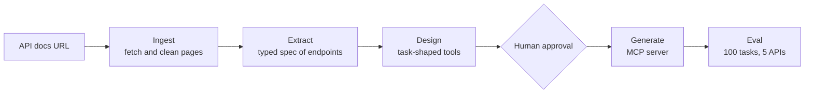

# docs2mcp

Turn messy API documentation into a curated, task-shaped [MCP](https://modelcontextprotocol.io) server, and measure whether agents actually do better with it.

[](https://github.com/dpelezo/docs2mcp/actions/workflows/ci.yml)


> **Status: in progress (week 1 of 4).** The spec models, `docs2mcp ingest`, `docs2mcp extract` and `docs2mcp score` work. Extraction has a first baseline on Frankfurter: 8 of 9 endpoints and 55% of their parameters ([details](evals/extraction/README.md)). Design, generation and the tool-use eval do not exist yet. The README will open with the eval numbers once they exist.

## Why

Most OpenAPI-to-MCP generators map each endpoint to one tool. Agents then see dozens of thinly described tools and have to chain calls themselves. docs2mcp reads the documentation directly (no OpenAPI file needed) and groups endpoints into a few tools shaped around real tasks, with descriptions written for an LLM. The reasoning is in [ADR 0001](docs/adr/0001-task-shaped-tools.md).

## Planned



| Week | Milestone |
|------|-----------|
| 1 | Ingest and extract: a docs URL becomes a validated, structured spec for five public APIs |
| 2 | Design and generate: a working MCP server per API, runnable locally |
| 3 | Eval harness: 100 tasks, an agent runner, and results against direct conversion |
| 4 | Demo and release: web playground, package on PyPI (`uvx docs2mcp`), write-up |

**Eval APIs** (public, no key needed): Open-Meteo, PokéAPI, REST Countries, Open Library and Frankfurter.

**Metrics:** task success rate, tool calls per task, tokens per task, and the share of invalid tool calls.

## Develop

Requires [uv](https://docs.astral.sh/uv/) and [just](https://just.systems).

```bash
git clone https://github.com/dpelezo/docs2mcp.git
cd docs2mcp
just setup     # install dependencies and pre-commit hooks
just check     # lint, type check and unit tests, the same as CI
```

Settings are read from environment variables; see [`.env.example`](.env.example).

### Ingest a documentation site

```bash
uv run docs2mcp ingest https://pokeapi.co/docs/v2 --out ingest/pokeapi
# Docs split across sibling folders: pass each one
uv run docs2mcp ingest https://openlibrary.org/dev/docs/api/search \
  https://openlibrary.org/dev/docs/api/books --out ingest/open_library
```

This writes `pages.jsonl` and `chunks.jsonl`: Markdown sections labelled with their heading path and a link back to the source. Pages are cached in `.cache/`, so re-runs are offline; pass `--refresh` to refetch. `just integration` runs the live tests against real sites. How it works: [ADR 0003](docs/adr/0003-ingest-pipeline.md).

### Extract an API spec

Needs `ANTHROPIC_API_KEY` in `.env`.

```bash
uv run docs2mcp extract ingest/pokeapi --out specs/pokeapi/spec.json --record recordings/pokeapi
uv run docs2mcp extract ingest/pokeapi --out specs/pokeapi/spec.json --replay recordings/pokeapi  # no API calls
```

Claude reads the chunks in batches and fills a flat schema; code validates each endpoint, repairs what is mechanical, sends the rest back to Claude with the errors, and merges everything into `spec.json`. `extraction_report.json` lists calls, tokens, merged duplicates, repairs and rejected endpoints. How it works: [ADR 0004](docs/adr/0004-extraction.md).

### Score an extraction

```bash
uv run docs2mcp score specs/frankfurter/spec.json --reference evals/extraction/reference/frankfurter.json
```

This compares the extracted endpoints and parameters with a reference built from the API's own OpenAPI file. Results and the baseline: [evals/extraction](evals/extraction/README.md). Rules: [ADR 0005](docs/adr/0005-extraction-scoring.md).

## How this repo is built

I build with AI coding agents and review everything they produce. The working rules every agent follows are in [`AGENTS.md`](AGENTS.md): run the baseline before changing code, keep unit tests off the network, never change an eval task in the same pull request as the code it measures, and report what was and was not verified.

## License

[MIT](LICENSE)
